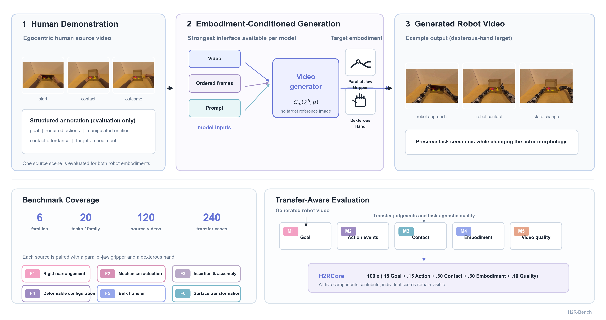

# H2R-Bench

**Benchmarking Human-to-Robot Manipulation Video Generation in World Models**

Dingyi Rong<sup>1,2</sup>, Yue Shi<sup>2&dagger;</sup>, Chaofan Ma<sup>1&ddagger;</sup>,
Jiezhang Cao<sup>1</sup>, Zongrui Wang<sup>1,2</sup>, Zeyu Zhang<sup>1,2</sup>,
Yao Mu<sup>1,2</sup>, Guangtao Zhai<sup>1,2&dagger;</sup>, Ning Liu<sup>1&dagger;</sup>

<sup>1</sup>&nbsp;Shanghai Jiao Tong University&nbsp;&nbsp; <sup>2</sup>&nbsp;Shanghai Artificial Intelligence Laboratory

<sup>&dagger;</sup>&nbsp;Corresponding authors.&nbsp;&nbsp; <sup>&ddagger;</sup>&nbsp;Project lead.

[](https://rongdingyi.github.io/H2R-Bench/)
[](https://arxiv.org/pdf/2608.13049)
[](https://arxiv.org/abs/2608.13049)
[](https://huggingface.co/papers/2608.13049)
[](https://github.com/Rongdingyi/H2R-Bench)

---

## Overview

**H2R-Bench** evaluates human-to-robot manipulation video generation: given a
human demonstration, can a video model reproduce the task with a robotic
end-effector?

The benchmark contains **120 scenes across 6 manipulation families**, paired
with **parallel-jaw grippers and dexterous hands** to form **240 transfer cases**.
We evaluate goal completion, action completion, functional contact, embodiment
correctness and video quality, summarized by **H2RCore**.



See the [paper](https://arxiv.org/abs/2608.13049) for the benchmark design,
metric definitions and experimental results.

## Leaderboard

H2RCore (0–100), higher is better.

| Model | Conditioning | Gripper | Hand |
|---|---|---|---|
| Seedance 2.0 | video | **77.3** | **84.6** |
| Wan2.7 | video | 76.5 | 83.1 |
| Kling-V3 | video | 74.5 | 81.7 |
| Mitty-EPIC14B | frame | 61.5 | 56.1 |
| Grok Imagine Video | frame | 50.1 | 49.2 |
| Veo 3.1 | frame | 49.6 | 57.0 |
| Wan2.2 | frame | 32.4 | 33.7 |
| LTX-2.3 | frame | 32.1 | 39.8 |
| SkyReels-V3-R2V | frame | 31.5 | 34.6 |
| LongCat | frame | 31.0 | 32.0 |
| HunyuanVideo 1.5-I2V | frame | 30.0 | 30.7 |

Full per-metric breakdown on the [project page](https://rongdingyi.github.io/H2R-Bench/).

## Benchmark and prompts

| Resource | Contents |
|---|---|
| [Scene IDs](benchmark/scene_ids.txt) | 120 scenes, 20 per manipulation family |
| [Annotations](benchmark/annotations.jsonl) | Corresponding entities, goal checks, action events and functional-contact specifications |
| [Generation prompts](prompts/generation.jsonl) | 240 prompts: one per scene and target embodiment |
| [Judge prompts](prompts/judging/) | M1–M4 scoring instructions and response formats |
| [Evaluation code](evaluation/) | Frame sampling, judge calls, M1–M5 scoring and aggregation |

Each scene has two generation prompts, one for `mechanical_arm` (parallel-jaw
grippers) and one for `dexterous_hand`. Use `scene_id` to match prompts and annotations.

## Quick start

### 1. Installation

Python 3.10+ is required.

```bash
git clone https://github.com/Rongdingyi/H2R-Bench.git
cd H2R-Bench
pip install -r requirements.txt
```

### 2. Prepare videos

Organize source and generated videos as follows, using the IDs in
[scene_ids.txt](benchmark/scene_ids.txt) and [generation.jsonl](prompts/generation.jsonl):

```text
source-videos/
  <scene_id>.mp4
generated-videos/
  <scene_id>__mechanical_arm/output.mp4
  <scene_id>__dexterous_hand/output.mp4
```

Create the evaluation manifest:

```bash
python -m evaluation.prepare \
  --source-dir /path/to/source-videos \
  --generated-dir /path/to/generated-videos \
  --model my-model \
  --output outputs/my-model/manifest.jsonl
```

### 3. Run M1–M4

Configure the API keys and OpenAI-compatible endpoints for the judges:

| Judge | Model | Environment variables |
|---|---|---|
| Qwen | `qwen3.7-plus` | `H2R_QWEN_API_KEY`, `H2R_QWEN_BASE_URL` |
| Gemini | `gemini-3.5-flash` | `H2R_GEMINI_API_KEY`, `H2R_GEMINI_BASE_URL` |
| GPT | `gpt-5.4` | `H2R_GPT_API_KEY`, `H2R_GPT_BASE_URL` |

```bash
python -m evaluation.run \
  --manifest outputs/my-model/manifest.jsonl \
  --output-dir outputs/my-model/judges \
  --providers qwen,gemini,gpt
```

Add `--dry-run` to preview the evaluation inputs and prompts.

Results are saved to `summary.csv` and `per_video.jsonl` in the summary directory.

## Citation

```bibtex
@article{rong2026h2rbench,
  title={H2R-Bench: Benchmarking Human-to-Robot Manipulation Video Generation in World Models},
  author={Rong, Dingyi and Shi, Yue and Ma, Chaofan and Cao, Jiezhang and Wang, Zongrui and Zhang, Zeyu and Mu, Yao and Zhai, Guangtao and Liu, Ning},
  journal={arXiv preprint arXiv:2608.13049},
  year={2026}
}
```
